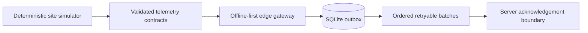

# Pacific Resilience

Offline-first infrastructure software for remote and island environments, beginning in Saipan, CNMI.

Pacific Resilience models site telemetry across grid, generator, battery, and critical-load systems while preserving data provenance through unreliable connectivity. The current slice is deliberately read-only toward physical equipment: it supports monitoring and human decision-making, never actuation.

## Why this exists

Remote sites cannot assume continuous cloud access, low-latency support, or a single reliable power source. The platform explores a practical architecture for:

- deterministic telemetry simulation;
- strict, versioned data contracts;
- an offline SQLite outbox;
- monotonic sequencing and idempotent batches;
- bounded retry and acknowledgement handling;
- explicit source, quality, and derivation metadata;
- recovery after connectivity loss without silently losing evidence.

## Current implementation



The repository currently contains:

- `packages/contracts` — Zod schemas and pure functions for telemetry envelopes, identifiers, provenance, quality, units, metrics, batches, and acknowledgements.
- `edge/simulator` — seeded scenarios for normal operation, outage/restore, battery bridging, and generator transfer.
- `edge/gateway` — durable SQLite outbox, monotonic sequencing, batch preparation, bounded retry, and acknowledgement processing.
- `docs/architecture` — ADRs and design notes covering provenance, offline sync, idempotency, naming, event detection, and testing.
- `docs/security` — threat model, data classification, secrets handling, and trust-boundary guidance.

## Verification status

The public baseline passes:

- 383 automated tests across 24 test files;
- TypeScript type checking for every implemented workspace;
- Biome checks;
- a repository secret-pattern check;
- `npm audit` with zero known vulnerabilities at release preparation time.

## Quick start

Requirements:

- Node.js 22
- npm

```bash
npm ci
npm run check
npm test
npm run typecheck
```

The current slice uses synthetic data and local SQLite only. It does not require cloud credentials or access to physical equipment.

## Design principles

1. Offline operation is a normal state, not an exception.
2. Evidence must retain origin, quality, timing, and derivation.
3. Retries must be bounded and idempotent.
4. Safety-critical control stays outside the current product boundary.
5. Synthetic fixtures must never be confused with field measurements.
6. Human operators remain responsible for physical actions.

## Project status

This is an early engineering project and portfolio-grade reference implementation, not a production energy-management system. Interfaces may change while the first vertical slice is completed.

The next milestones are a local ingest service, replayable outage demonstrations, operator-facing event timelines, and a documented recovery drill.

## Security and safety

Please do not connect this software to breakers, transfer switches, generators, batteries, or other safety-critical equipment. Report potential security issues privately as described in [SECURITY.md](SECURITY.md).

## Contributing

Small, test-backed improvements and architecture discussions are welcome. See [CONTRIBUTING.md](CONTRIBUTING.md).

## License

MIT © 2026 Jeremy Pabalan
