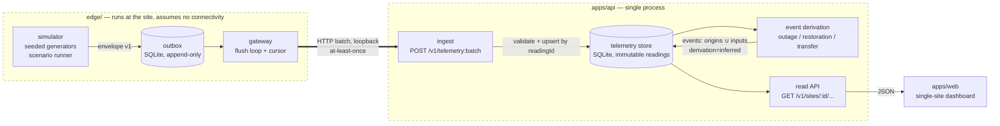

# System overview — Slice 0

Scope: the Slice 0 architecture only. Anything not shown here is deferred.
Decisions are recorded in `adr/`; terms are defined in
`../product/glossary.md`.

## Purpose

Slice 0 proves four properties end to end, using simulated telemetry only:

1. **Normalization** — heterogeneous readings share one validated envelope.
2. **Offline durability** — no acknowledged reading is lost across a connection
   loss or process kill.
3. **Idempotent synchronization** — replaying data produces no duplicates, and no
   legitimate reading is discarded as one.
4. **Explicit provenance** — every value carries both its origin and its derivation
   method, all the way to the pixel.

It deliberately proves nothing about vendor hardware, multi-tenancy, or control.
Control is excluded permanently at this layer — see `../security/safety-boundary.md`.

## Components

### Responsibilities

| Component | Owns | Must not |
| --- | --- | --- |
| `edge/simulator` | Generating the Site 001 signal set deterministically from a seed and a scenario file; assigning each reading its `readingId` | Emit any reading whose `origins` is other than `["simulated"]` |
| `edge/gateway` | Durable buffering, sequencing, flush, backoff, cursor advance | Drop a reading before it is acknowledged; mutate a buffered reading; alter a `readingId` on retry |
| `apps/api` ingest | Schema validation, idempotent upsert keyed on `readingId`, batch accounting | Accept an envelope missing `origins` or `derivation`; generate a `readingId`; mutate an existing reading |
| `packages/event-detection` | Deriving events from reading series by pure functions | Read storage, the clock, or configuration |
| `apps/api` read | Serving current state, series, and events with both provenance dimensions and lineage attached | Return a value stripped of either dimension |
| `apps/web` | Displaying values, both provenance dimensions, staleness, and events | Present any control affordance; render a bare value |

## Data flow

1. The simulator produces readings at a fixed cadence, assigns each an opaque
   `readingId`, and writes them into the outbox with a monotonic per-gateway
   `sequence` — durably, before any network attempt.
2. The gateway flushes contiguous sequence ranges as batches over HTTP on loopback,
   reusing each `readingId` unchanged on every retry. It advances its cursor **only**
   on server acknowledgement.
3. Ingest validates every envelope against schema v1, rejecting the whole batch on
   any structural failure, and upserts readings keyed on `readingId`. Readings are
   immutable; a repeat ID with an identical payload is a no-op, and a repeat ID with
   a differing payload fails the batch rather than resolving it.
4. Event derivation runs over reading series and writes events with
   `derivation: "inferred"` and `origins` set to the union of their inputs' origins,
   each linked by lineage to the readings it came from.
5. The read API serves current values, recent series, event history, and gateway
   last-seen. Both provenance dimensions travel with every value.
6. The dashboard renders values with origin and derivation labels, a SIMULATED
   banner, a staleness indicator, and the event timeline.

## Trust boundaries

| Boundary | Crossing | Treatment |
| --- | --- | --- |
| Simulator → outbox | In-process | Typed; validated at construction |
| Gateway → ingest | **HTTP, loopback in Slice 0** | Untrusted input. Full schema validation, size limits, no partial acceptance |
| Store → read API | In-process | Typed; both provenance dimensions carried, never defaulted |
| Read API → browser | **HTTP, loopback in Slice 0** | Read-only. No mutating endpoint exists for physical assets |

The gateway-to-ingest hop is the only boundary where untrusted input enters, and it
is the only place runtime validation is mandatory rather than defensive.

**Slice 0 uses plain HTTP on loopback with no authentication and no TLS.** That is
acceptable only because every component runs on one machine with simulated data, and
it is permitted for this environment alone. TLS and per-gateway authentication become
mandatory before any gateway communicates across a network — tripwired to the first
non-loopback listener in `../security/threat-model.md`.

## What Slice 0 does not include

- Any device, vendor, protocol, or utility integration. No adapter exists for
  the Anker SOLIX system, the building transfer switch, or CUC. See
  `../product/site-001-profile.md` for why: nothing is verified.
- Any write path toward a physical asset, in any component, at any layer.
- Authentication, authorization, tenancy beyond one hard-coded organization.
- TLS. Slice 0 has no certificates and makes no transport-security claim.
- PostgreSQL, MQTT, Redis, object storage, containers, Python (ADR 0003, ADR 0002).
- Configuration-change audit trail: deferred with the configuration surface
  that would produce entries (decision D16).
- Rates, fuel-adjustment charges, cost, and savings analysis. Present in the
  charter's problem statement; explicitly out of Slice 0 scope.
